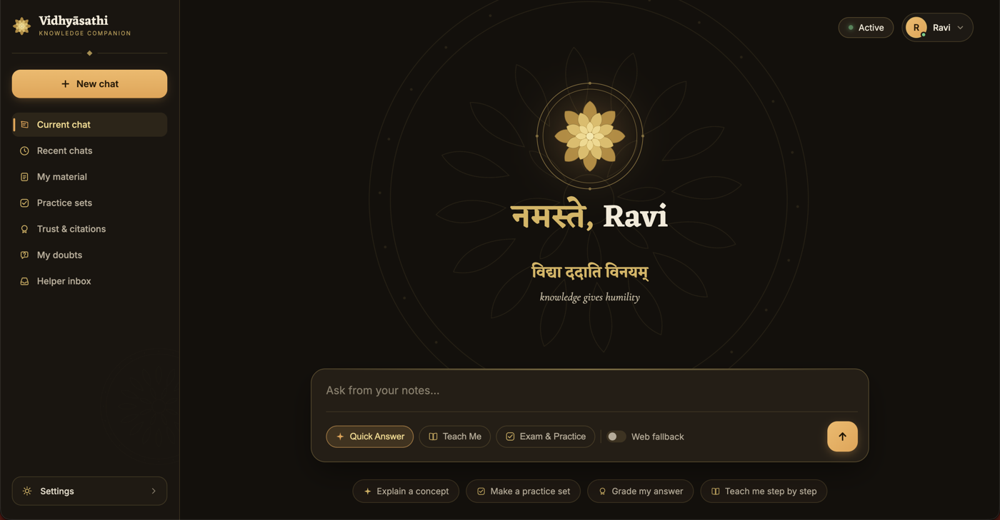
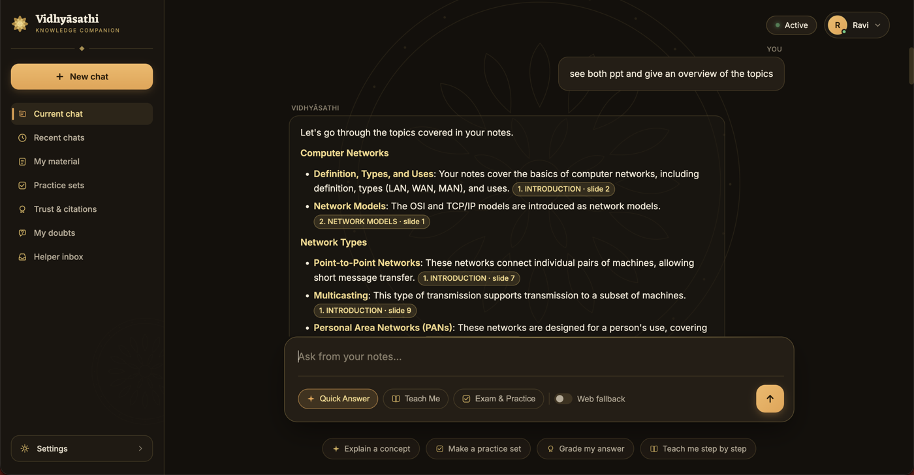
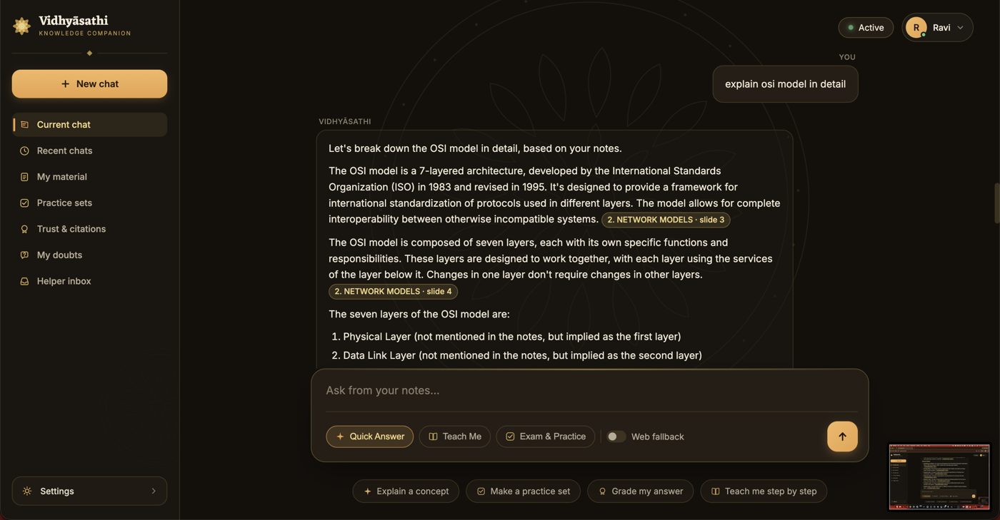
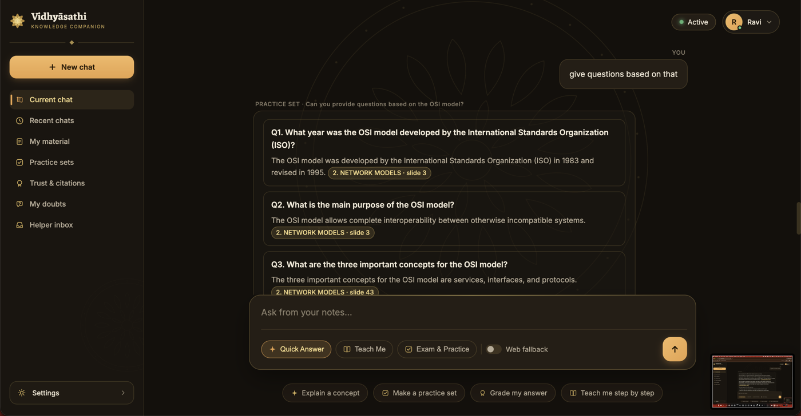
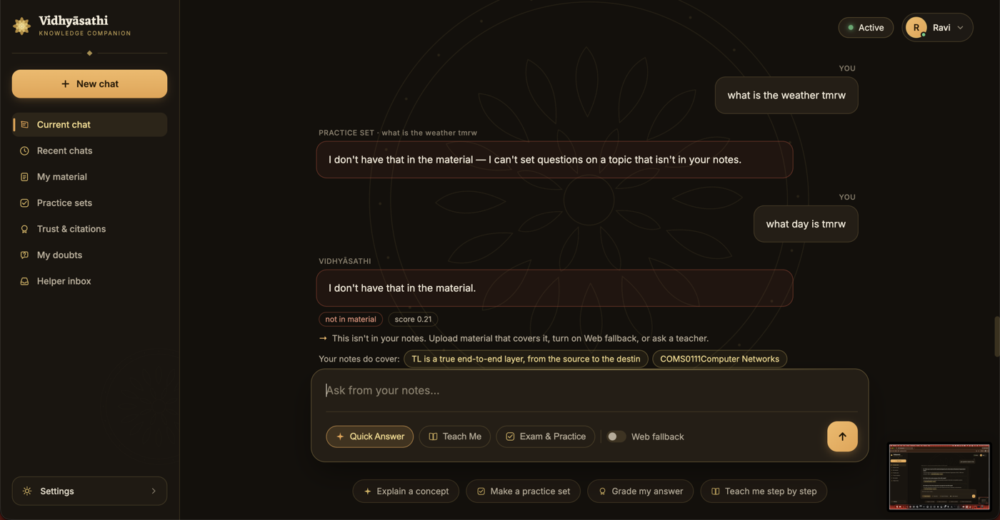
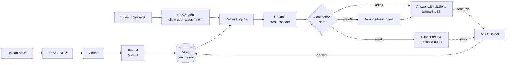

<div align="center">

# 🪷 Vidhyāsathi

### An honest, grounded study companion

**विद्या ददाति विनयम्** — *knowledge gives humility*

*Answer when grounded. Be honest when unsure. Escalate when it matters.*


-000000)




</div>

---

## What is it?

**Vidhyāsathi** ("knowledge companion") is a local AI study assistant that answers **only from a student's own notes**: slides, PDFs, documents, spreadsheets and even scanned or handwritten pages. Every answer cites the exact slide or page it came from. When the notes don't cover something, it **says so honestly** instead of guessing. When a student is still stuck, it hands the doubt to a **real teacher**, and their reply becomes part of the notes.

Everything runs on a laptop: Llama 3.1 8B, the embeddings and the vector database. No student data leaves the machine.

> Semester 5 mini-project · B.Tech CSE (Data Science) · **Chinmaya Vishwa Vidyapeeth (CVV)**, Ernakulam
> **Team:** Ravishankar Varier R · Krishna N U  **Guide:** Dr. Soumya Haridas

---

## ✨ Features

| | |
|---|---|
| 📚 **Grounded answers** | Answers come only from your uploaded material, with a citation such as `[2. NETWORK MODELS · slide 4]` on every fact |
| 🛡️ **Honesty gate** | A three-band confidence gate (inspired by CRAG): answer, answer with a warning, or refuse, and never invent |
| 🧑‍🏫 **Teach Me** | A one-idea-at-a-time tutor that adapts to "ok", "next" and "I don't get it" |
| 📝 **Exam & Practice** | Generates cited practice questions and gives four-part feedback (Correct · Missing · Incorrect · Suggestion) on your answers |
| 🙋 **Ask a Helper** | Sends a doubt to *one* matched teacher, showing who before you send; their answer is added to your notes |
| 💬 **Natural conversation** | Understands follow-ups ("teach me it"), reactions, pushback and typing slips ("osimodel" → "osi model") |
| 🗂️ **Any format** | PDF · PPTX · DOCX · XLSX · CSV · TXT · MD · images, with OCR for scanned and handwritten notes |
| 🔒 **Private by design** | Per-student isolation, local model, and an owner-only `private/` folder that is never committed |
| 🌐 **Optional web fallback** | Off by default; anything from the web is always labelled as web, never passed off as your notes |

---

## 📸 Screenshots

<table>
<tr>
<td width="50%"><br><sub><b>Overview across documents:</b> "see both ppt and give an overview of the topics", with every point cited</sub></td>
<td width="50%"><br><sub><b>Explain in detail:</b> a structured answer that cites the exact slides</sub></td>
</tr>
<tr>
<td width="50%"><br><sub><b>Practice that follows the chat:</b> "give questions based on that" → questions on the OSI model, each with a cited answer</sub></td>
<td width="50%"><br><sub><b>Honest refusal:</b> off-topic questions are declined, and the app points to what the notes <i>do</i> cover</sub></td>
</tr>
</table>

---

## 🧠 How it works



### The honesty gate

| Retrieval score | Behaviour | Label |
|---|---|---|
| **≥ 0.55** | Trust retrieval and answer (skipping the extra check halves latency) | `grounded` |
| **0.30 – 0.55** | The LLM checks whether these passages really cover the question | `grounded` / `tentative` |
| **< 0.30** | Refuse honestly and suggest the closest topics in the notes | `not in material` |

### Research it builds on
CRAG (Yan 2024) · Adaptive-RAG (Jeong 2024) · Graph RAG (Edge 2024) · RAGChecker (Ru 2024) · Agentic RAG Survey (Singh 2025) · Hallucination Survey (Huang 2024) · LLMs for Education (Wang 2024) · RAG Short-Answer Grading (Chu 2025). Full citations are in the [project report](docs/Vidhyasathi-Project-Report.pdf).

---

## 🚀 Quick start (macOS)

**Prerequisites:** [Docker Desktop](https://www.docker.com/products/docker-desktop/), [Ollama](https://ollama.com), Python 3.11+, and optionally `cloudflared` for a public link.

```bash
git clone https://github.com/raaaviiiii/vidhyasathi.git
cd vidhyasathi
./start.sh --install     # one time: adds the vstart / vstop / vcheck commands
source ~/.zshrc

vstart                   # Docker → Qdrant → Ollama (pulls llama3.1:8b) → app → public link
vstop                    # stop everything
vcheck                   # run every test, a live check against the real model, and the evaluation
```

Then open **http://localhost:8000**, create an account, upload your notes under **My material**, and ask away.

Optional settings go in `private/.env`:
```bash
VS_ADMIN_EMAILS=you@example.com      # owner tools: make helpers, see stats
ANTHROPIC_API_KEY=...                # only for OCR of scanned/handwritten pages
```

---

## 🗂️ Project structure

```
vidhyasathi/
├── app.py              FastAPI server: accounts, uploads, answers, practice, Ask a Helper
├── start.sh · stop.sh  one-command start / stop
├── src/                the engine
│   ├── ingest.py · ocr.py · chunk.py · embed.py · store.py     notes → vectors
│   ├── retrieve.py · rerank.py · answer.py                     search → gate → answer
│   ├── converse.py     conversation layer (follow-ups, reactions, typos, slide recall)
│   ├── exam.py · grade.py · doubts.py · eval.py
├── web/index.html      the whole interface (Markdown + KaTeX)
├── scripts/            vcheck autopilot, live smoke test, real-notes evaluation
├── tests/              456 backend tests (pytest) + 186 UI tests (JSDOM)
├── docs/               project report (PDF/MD), QA spec and reports, screenshots
└── private/            🔒 accounts, uploads, knowledge base, logs: never committed
```

---

## ✅ Quality

| Check | Result |
|---|---|
| Backend tests (pytest, real Qdrant) | **456 passing** |
| UI tests (JSDOM) | **186 passing** |
| Live end-to-end checks (real Llama 3.1) | **18 / 18** |
| Honest refusal on off-material questions | **100%** |
| Judged answer accuracy | **75%** |
| Typical response time (MacBook Pro M4 Pro) | **≈ 2–4 s** |

The **evaluation harness** (`python scripts/eval_real.py`) drafts a test set from your own notes and measures MRR@10 and Recall@5 against a BM25 baseline, judged accuracy and refusal honesty, all on a temporary copy of your data.

---

## 🛣️ Roadmap

- Fine-tune a small model (LoRA) on course material and helper answers
- Grade handwritten answer sheets (photo → OCR → grounded feedback)
- Let the model itself route every message, for even more natural conversation
- Spaced-repetition practice on weak topics
- Malayalam and Hindi questions
- Permanent hosted deployment

---

## 📄 Documentation

- 📘 **[Full project report (PDF)](docs/Vidhyasathi-Project-Report.pdf)**: problem, design, evaluation, challenges, references
- 📝 [Project report (Markdown)](docs/Vidhyasathi-Project-Report.md)
- 🧪 [QA specification](docs/qa/SPEC.md) and [test reports](docs/qa/reports/)

---

<div align="center">
<sub>Built with care at CVV · 2026 · <i>Vidhyāsathi — your knowledge companion</i></sub>
</div>
